# Documentación de red institucional

Aplicación web multilingüe para organizar el inventario y el seguimiento de un proyecto de documentación de red. Esta es la **versión personal de portafolio**: funciona en tu computadora con SQLite y puede cargarse con registros ficticios. No contiene información de una red institucional real.

Repositorio público: [moises382/documentacion-red-institucional](https://github.com/moises382/documentacion-red-institucional).

## Así se ve el proyecto

Estas capturas muestran la **versión personal ejecutada con datos ficticios** mediante `npm run seed:demo`. Los nombres de equipos, las direcciones IP y las cifras de las imágenes son ejemplos; no describen una red institucional real. Las imágenes 12 a 15 muestran el diseño y las interacciones actuales; las anteriores documentan la evolución del proyecto.

### Resumen del proyecto

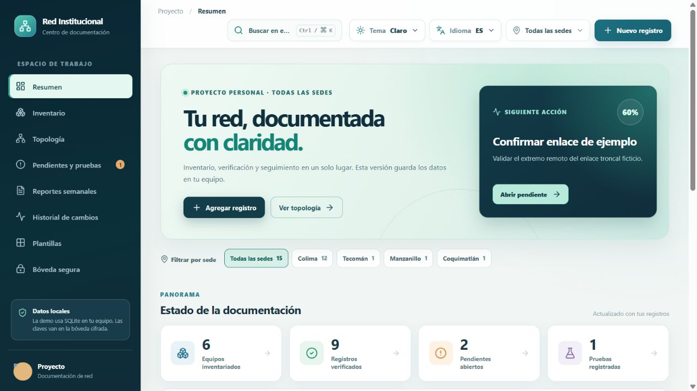

El inicio muestra una acción prioritaria basada en pendientes reales, filtros rápidos por sede e indicadores que llevan a la lista correspondiente. También separa el **estado de uso del equipo** (activo, inactivo, no utilizado o por confirmar) del **estado de verificación de sus datos**.

### Búsqueda rápida

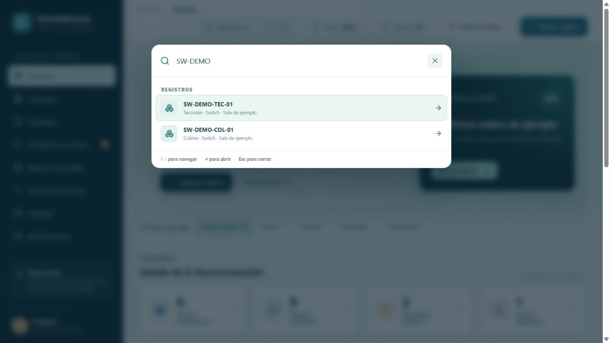

El botón **Buscar en el proyecto** abre una búsqueda de secciones y registros. Escribe un nombre, una dirección IP o una sede; al elegir el resultado se abre la ficha. En Windows se puede usar **Ctrl+K** y en macOS **⌘K**. También admite flechas y Enter.

### Vista en teléfono

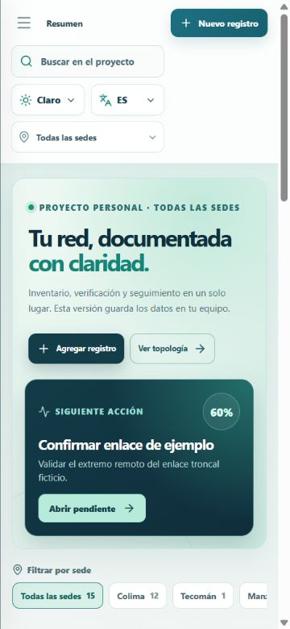

La barra organiza búsqueda, tema, idioma, sede y alta de registros en controles visibles. Los filtros de sedes pueden desplazarse horizontalmente sin mover toda la página.

### Inventario de equipos

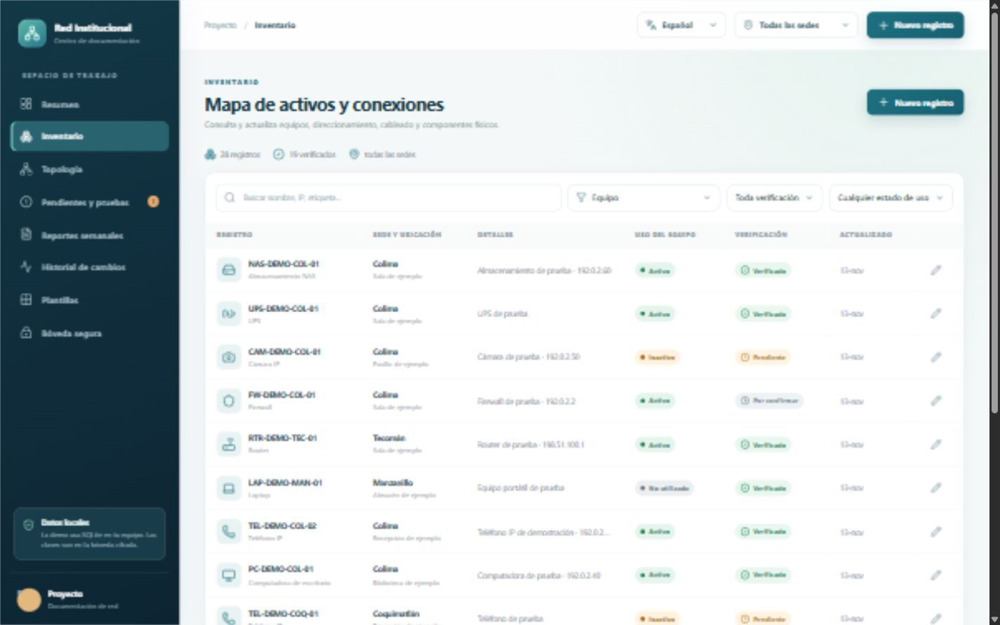

La tabla permite buscar y filtrar por sede, tipo de registro, verificación y estado de uso. En el ejemplo aparecen una computadora activa, una cámara inactiva y una laptop no utilizada; cada fila conserva su ubicación y un acceso para consultar o editar la ficha.

### Etiquetas de cableado

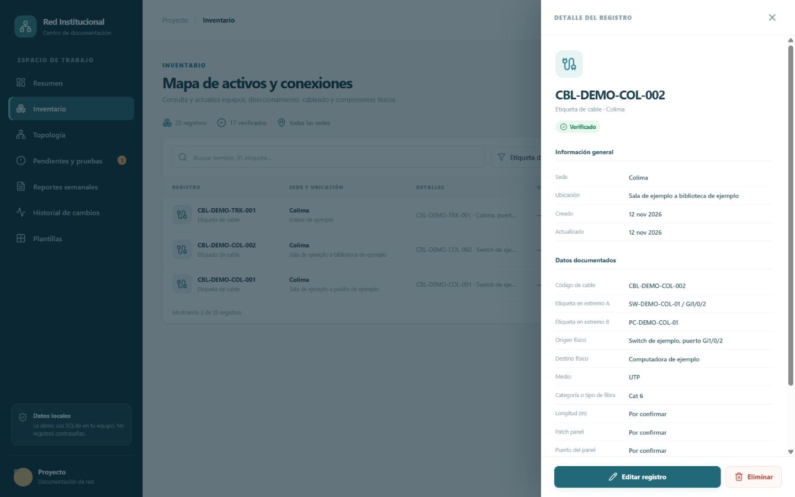

Cada cable puede documentarse con un código visible, etiqueta en ambos extremos, origen y destino físico, medio y categoría. Los datos que todavía faltan se muestran como **Por confirmar**, para que la ficha no dé una falsa impresión de estar completa.

### Topología

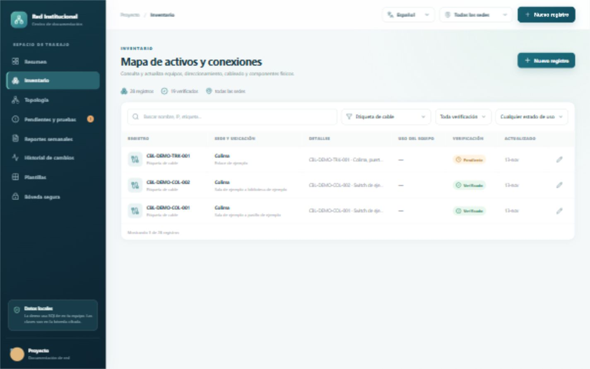

El visor organiza los equipos por sede y dibuja las conexiones registradas entre ellos. Es una representación de la documentación guardada: **no realiza un escaneo automático de la red**. Debajo de cada diagrama también aparecen las referencias físicas de cableado.

### Teléfono IP y componentes

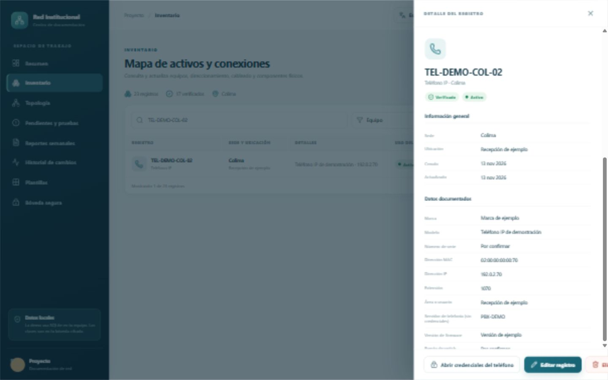

La ficha del teléfono conecta la extensión, dirección MAC, servidor de telefonía, puerto de switch, cable, nodo, alimentación PoE y computadora conectada al puerto PC. Las diademas, auriculares, módulos y fuentes se documentan como componentes independientes, vinculados al teléfono y con su propio estado de uso.

### Bóveda de credenciales

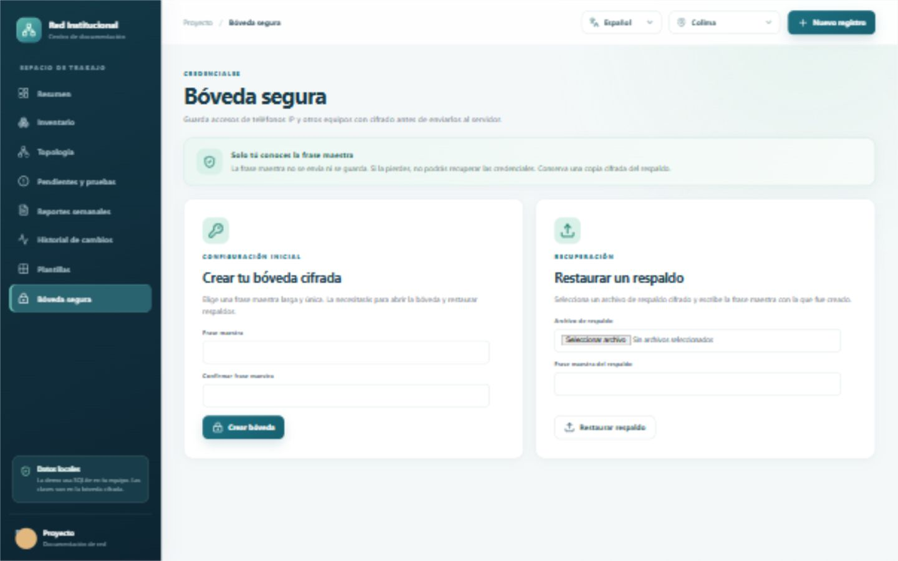

Los usuarios y contraseñas van en una **bóveda separada del inventario**. Se cifra en el navegador con una frase maestra; permite descargar e importar respaldos cifrados. La imagen muestra la bóveda vacía, sin secretos de demostración.

### Central telefónica / PBX

La plantilla de central telefónica reúne la identificación del conmutador, IP y VLAN de voz, extensiones, troncales SIP, puertos FXO y FXS, rutas de llamadas, IVR, grabación, rack, UPS y continuidad. Cada teléfono IP puede vincularse a la central. Al guardar una central nueva se abre su ficha, desde donde el botón de credenciales lleva a la bóveda cifrada para guardar por separado el usuario y la contraseña de administración, de la troncal SIP u otros accesos.

### Apariencia oscura y controles de preferencias

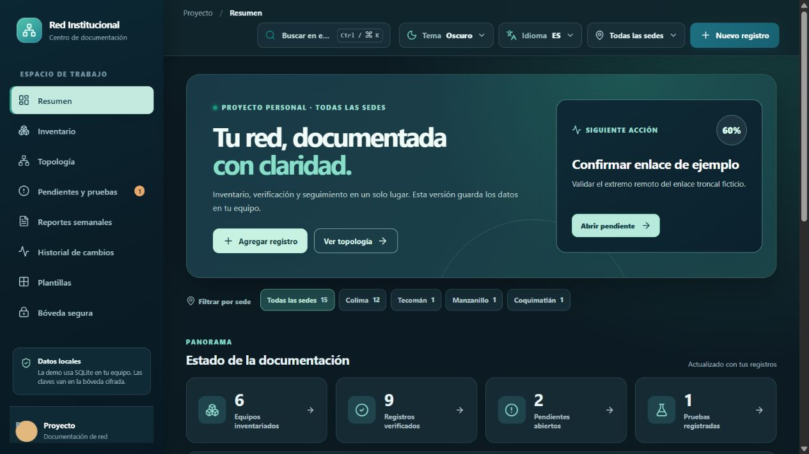

La vista oscura adapta el panel, el inventario, los formularios, la topología y la bóveda. El control **Tema** ofrece **Claro**, **Oscuro** y **Automático**; este último sigue la preferencia de apariencia de Windows o macOS.

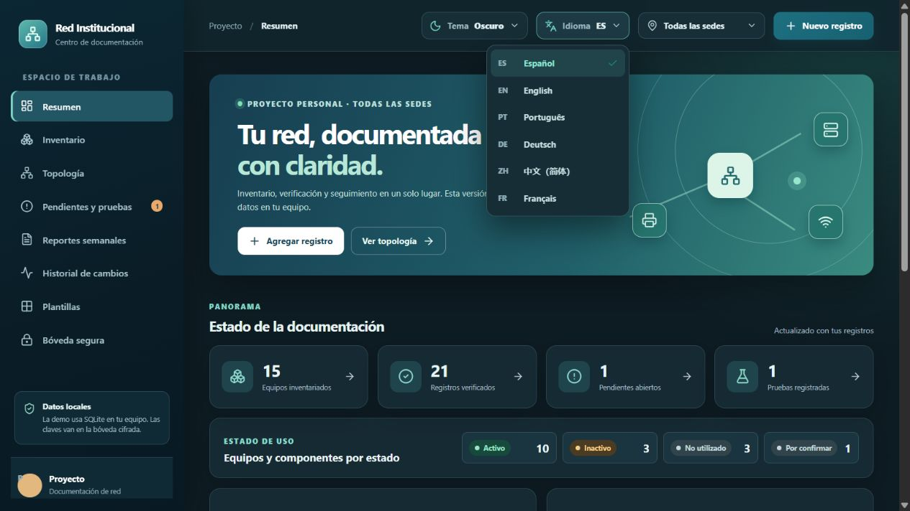

El botón **Idioma** cambia los textos de la interfaz entre seis lenguas. El contenido que una persona escriba en sus fichas permanece tal como fue registrado. Tanto el idioma como el tema elegidos se recuerdan en ese navegador.

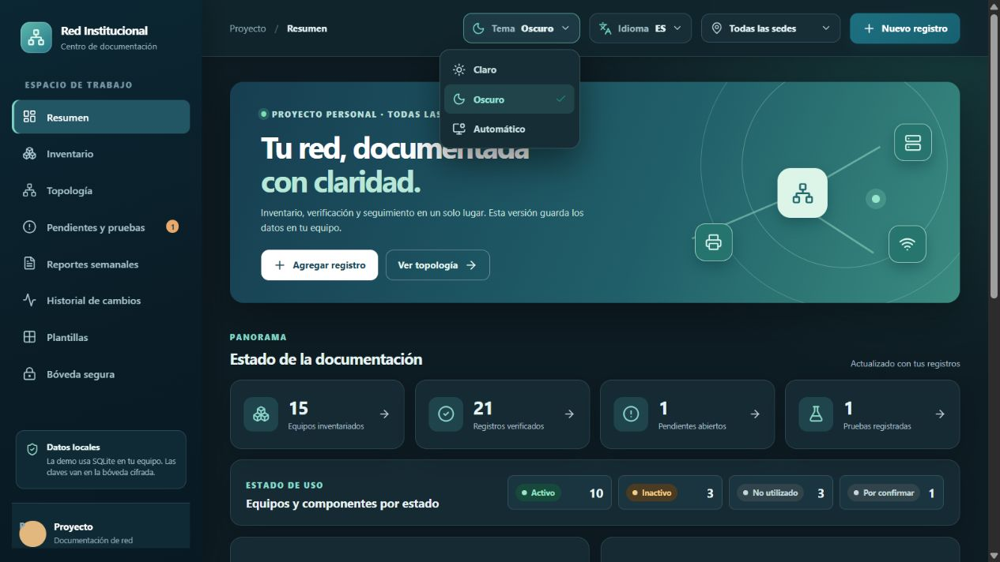

Las traducciones forman parte del código del proyecto: cambiar de idioma no envía inventario ni credenciales a un servicio de traducción.

Consulta la [galería completa con explicación de las quince pantallas](docs/CAPTURAS.md), incluidos el reporte semanal y las plantillas.

## Funciones

- Inventario editable de equipos, direcciones IP, puertos, VLANs, etiquetas de nodos y cables, racks, patch panels, enlaces troncales y dispositivos PoE.
- Plantillas reutilizables para switches, computadoras, laptops, impresoras, puntos de acceso, teléfonos IP, centrales telefónicas / PBX, servidores, routers, firewalls, cámaras IP, UPS y NAS.
- Ficha de central telefónica IP, virtual o digital con capacidad, extensiones, troncales SIP, puertos, rutas entrantes y salientes, IVR, colas, grabación, ubicación y respaldo de configuración; vínculo a teléfonos IP y accesos resguardados en la bóveda.
- Fichas de componentes de teléfono IP: auriculares, diademas, módulos de expansión, fuentes, inyectores PoE y cables, vinculadas al teléfono.
- Estado de uso de equipos y componentes independiente de la verificación: **activo**, **inactivo**, **no utilizado** o **por confirmar**, con motivo y filtro en el inventario.
- Diagrama de topología generado a partir de equipos y conexiones documentadas.
- Pendientes, inconsistencias automáticas por IP, puerto o etiqueta de cable duplicados, y registro de pruebas.
- Estados **verificado**, **pendiente** y **por confirmar**.
- Historial de altas, cambios y eliminaciones.
- Reportes semanales con borrador basado en los registros de la semana y descarga en Markdown.
- Filtros por Colima, Tecomán, Manzanillo y Coquimatlán.
- Búsqueda rápida de secciones y fichas con atajo de teclado; indicadores y filtros de sede que abren directamente los registros correspondientes.
- Diseño adaptable con temas claro, oscuro y automático; selector de español, inglés, portugués, alemán, chino simplificado y francés. Las preferencias se guardan en el navegador.
- Bóveda de credenciales cifrada en el navegador y respaldo cifrado descargable, separada de los registros técnicos.
- Resumen lateral de red que se actualiza al guardar cambios: subred IPv4, máscara, equipos, IP fijas, computadoras DHCP, puerta de enlace, reserva de crecimiento y direcciones necesarias. Se puede documentar más de una red mediante la plantilla **Plan de red**.
- Botón **Crear PDF** en la barra derecha y en cada ficha para descargar cualquier registro. El PDF incluye datos técnicos y excluye las credenciales de la bóveda.
- Botón **Cargar ejemplo** abajo a la izquierda. Abre una oficina ficticia con 43 equipos y un plan `192.168.1.0/24`, tal como en la captura de referencia. El ejemplo se guarda solo en ese navegador; puedes editarlo y volver a tus datos reales sin mezclarlos. Cambia el nombre de la oficina editando el registro **Plan de red**.

## Tecnologías

Next.js, React, TypeScript, CSS y SQLite mediante el módulo `node:sqlite` de Node.js. La aplicación usa una ruta API local para guardar y consultar registros.

## Instalación rápida

Necesitas **Node.js 24 o posterior** y npm en Windows o macOS.

1. Descarga el código del repositorio desde **Code → Download ZIP** en GitHub y descomprímelo, o clónalo con Git.
2. Abre una terminal en la carpeta del proyecto.
3. Ejecuta:

   ```bash
   npm ci
   npm run dev
   ```

4. Abre [http://127.0.0.1:3000](http://127.0.0.1:3000).

5. Presiona **Cargar ejemplo** en el menú izquierdo para explorar un proyecto completo sin llenar formularios. `npm run seed:demo` sigue disponible para generar registros ficticios en la base local si quieres probar ese flujo por separado.

`seed:demo` es opcional. Solo añade datos ficticios cuando la base está vacía. Para comenzar sin ejemplos, omite ese comando.

Lee [INSTALACION.md](INSTALACION.md) para las instrucciones detalladas en Windows y macOS.

## Comprobaciones

```bash
npm run typecheck
npm test
npm run build
```

## Datos y privacidad

Los registros locales y la bóveda cifrada se guardan en `data/network.sqlite`, carpeta excluida de Git. Los nombres e IP del script de demostración son ficticios; los rangos IP son de documentación. **No añadas contraseñas, tokens, claves ni datos reales de una red institucional al repositorio.** Usa la bóveda para los secretos.

La frase maestra nunca se envía ni se guarda. **Si la pierdes, no existe recuperación**; conserva la frase y un respaldo cifrado en lugares seguros. El respaldo descargado permanece cifrado. Consulta [SEGURIDAD.md](docs/SEGURIDAD.md) para el uso y los límites de esta función.

La aplicación personal escucha en `127.0.0.1` y no incorpora inicio de sesión. Está pensada para ejecutarse en tu equipo y mostrar el código en GitHub. Para publicarla como servicio accesible por Internet se necesitaría añadir autenticación, control de permisos y una base de datos administrada. GitHub Pages no ejecuta esta aplicación de servidor.

La versión original alojada en Sites usa una base de datos en la nube y conserva su acceso privado; este repositorio es una adaptación independiente para portafolio.

## Estructura

- `app/dashboard.tsx`: interfaz, filtros, formularios y diagramas.
- `app/api/data/route.ts`: operaciones de lectura y escritura.
- `app/api/vault/route.ts` y `lib/vault.ts`: almacenamiento cifrado y cifrado en el navegador.
- `app/i18n.tsx` y `app/locales/`: textos y preferencia de idioma.
- `app/theme.tsx`, `app/preferences.tsx`, `app/theme.css` y `app/experience.css`: temas, controles y diseño adaptable.
- `lib/models.ts`: tipos y plantillas de documentación.
- `lib/record-validation.ts`: validación de los registros.
- `lib/database.ts`: creación de tablas y acceso SQLite.
- `scripts/seed-demo.mjs`: datos ficticios opcionales.
- `tests/`: comprobaciones de validación y persistencia.

Más detalles en [ARQUITECTURA.md](ARQUITECTURA.md). Una descripción lista para adaptar a tu currículum está en [DESCRIPCION_CV.md](DESCRIPCION_CV.md).
