# Galería y recorrido del proyecto

Las imágenes siguientes son capturas de la **aplicación personal** ejecutada en una computadora con una base SQLite de demostración. Se generaron con `npm run seed:demo` sobre una base vacía: los equipos, nombres, ubicaciones, direcciones IP, avances y fechas son ficticios. No se muestran credenciales ni datos de una red institucional real. Las primeras once imágenes conservan etapas anteriores del proyecto. Las capturas 12 a 15 muestran el diseño actual.

## 1. Resumen: estado general del trabajo

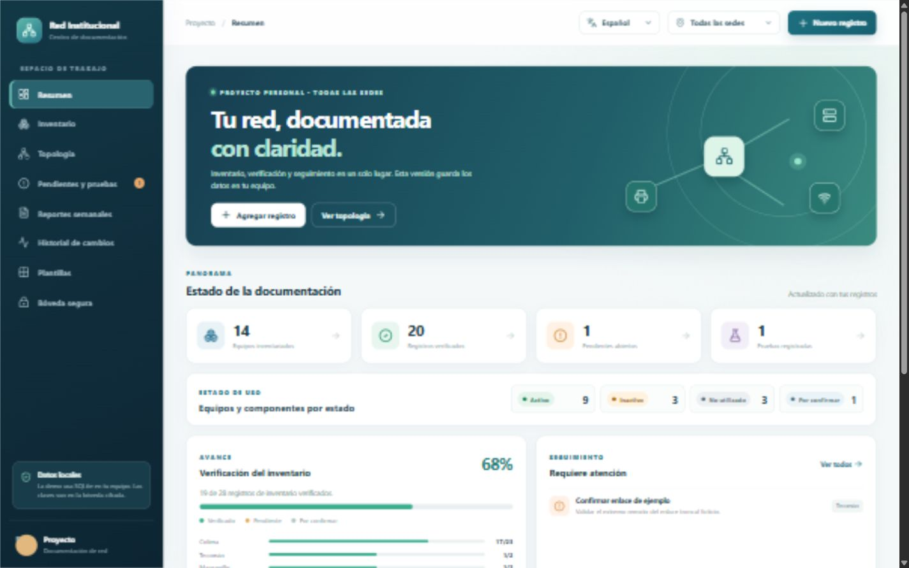

Esta es la primera pantalla al abrir el proyecto. La fila de indicadores resume cuántos equipos están inventariados, cuántos registros se verificaron, cuántos pendientes siguen abiertos y cuántas pruebas se documentaron. Son cifras calculadas a partir de los registros de la base local, no valores fijos de la interfaz.

La franja **Estado de uso** cuenta los equipos y componentes activos, inactivos, no utilizados y pendientes de confirmación. Al elegir una categoría se abre el inventario con ese filtro. Más abajo, **Verificación del inventario** mide la revisión de los datos y desglosa el avance por Colima, Tecomán, Manzanillo y Coquimatlán. Un equipo puede estar inactivo y tener sus datos verificados: ambas condiciones se registran por separado.

## 2. Inventario: localizar y clasificar equipos

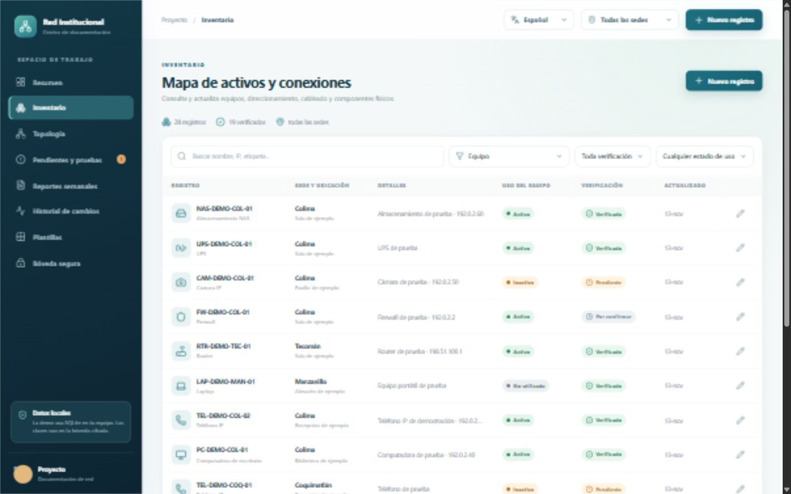

La imagen muestra el inventario filtrado por **Equipo**. Cada fila presenta identificador, tipo, sede, ubicación, un resumen técnico, estado de uso, verificación y fecha de actualización. Los registros de ejemplo incluyen distintos tipos de equipo y muestran de forma visible la diferencia entre **Inactivo** y **No utilizado**.

El buscador y los filtros permiten acotar la lista por sede, tipo de registro, estado de verificación o estado de uso. Al abrir una fila se ve la ficha completa; el control de edición permite corregirla. El inventario también admite direcciones IP, puertos de switch, VLAN, nodos, etiquetas de cable, racks, patch panels, enlaces troncales y dispositivos PoE.

## 3. Cableado: seguir una etiqueta de extremo a extremo

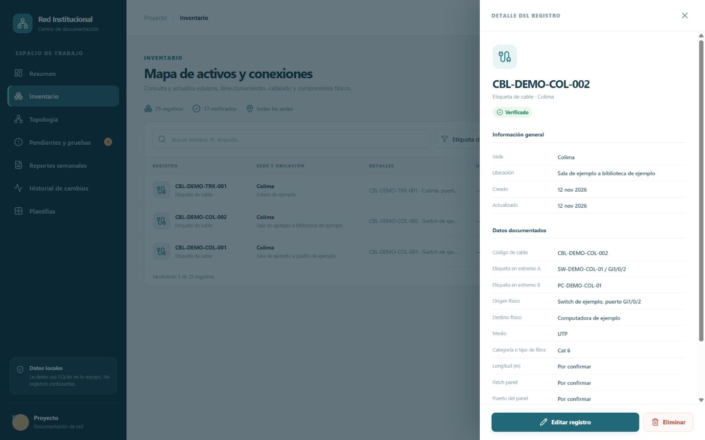

Aquí se abrió la ficha ficticia `CBL-DEMO-COL-002`. Se ve el **código de cable**, la etiqueta del extremo A (`SW-DEMO-COL-01 / Gi1/0/2`) y la del extremo B (`PC-DEMO-COL-01`). También aparecen el origen y el destino físico, el medio UTP y la categoría Cat 6. Así se puede relacionar una toma o un puerto con el equipo del otro extremo sin depender solo de un dibujo.

La ficha reserva campos para longitud, patch panel, puerto de panel y etiqueta de nodo. Si aún no se conoce un dato, aparece como **Por confirmar**. El estado de verificación indica si la documentación fue revisada; el estado del cable describe su condición operativa. Los códigos duplicados de etiquetas pueden señalarse entre las inconsistencias automáticas.

## 4. Topología: ver equipos y conexiones documentadas

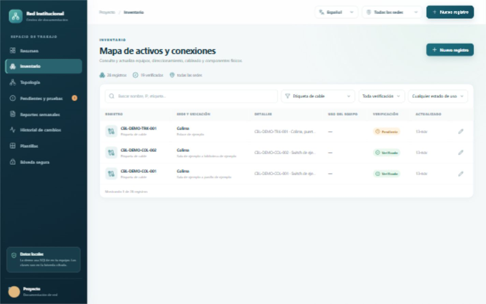

El visor agrupa los equipos por sede. En el diagrama de ejemplo de Colima se distinguen switch, servidor, computadora, cámara, punto de acceso, firewall, NAS y UPS. Las líneas unen los extremos documentados en puertos o enlaces; los colores y marcas ayudan a reconocer registros verificados y equipos con diferentes estados de uso.

Debajo de los diagramas se listan las referencias físicas del cableado, como etiquetas y patch panels. También hay una sección para enlaces entre sedes. **La topología refleja lo que se ha registrado en la aplicación**: no descubre equipos ni inspecciona la red automáticamente. Si falta documentar un enlace, tampoco aparecerá como conexión confirmada en el diagrama.

## 5. Reporte semanal: dejar constancia del avance

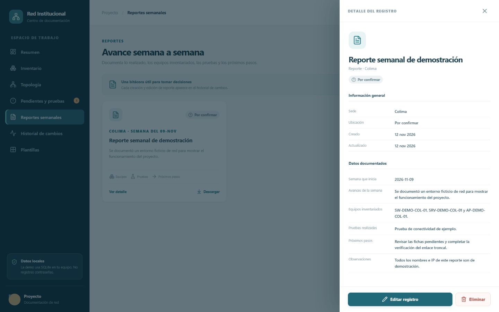

La captura abre un reporte semanal ficticio. Su ficha reúne la semana, los avances, los equipos inventariados, las pruebas realizadas, los próximos pasos y las observaciones. Esto permite retomar el proyecto sin reconstruir de memoria qué se revisó y qué falta.

Cada reporte tiene sede y estado de verificación, queda registrado en el historial de cambios y se puede descargar en formato Markdown. Al crear un reporte nuevo, la aplicación ofrece un borrador basado en la actividad de la semana, que se puede revisar y editar antes de guardarlo.

## 6. Plantillas: empezar cada ficha con los campos adecuados

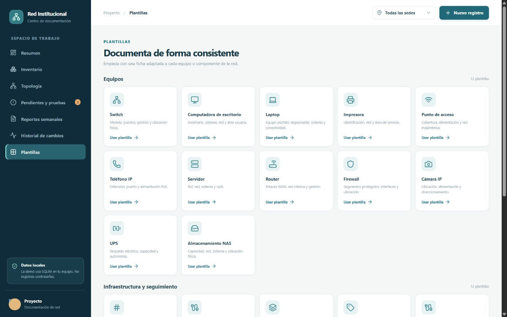

La pantalla de plantillas ofrece formularios adaptados a **13 tipos de equipo**, entre ellos switch, computadora de escritorio, laptop, impresora, punto de acceso, teléfono IP, central telefónica / PBX, servidor, router, firewall, cámara IP, UPS y NAS. Cada tipo pide los datos pertinentes; por ejemplo, la computadora tiene inventario, sistema operativo y área usuaria, mientras que el switch permite registrar puertos y gestión.

Hay otras **13 plantillas** para infraestructura y seguimiento: componente de teléfono IP, IP, puerto, VLAN, nodo, cable, rack, patch panel, enlace troncal, PoE, pendiente, prueba y reporte. Al pulsar **Usar plantilla** se abre un formulario editable. El registro se crea al guardar el formulario, y después puede consultarse o actualizarse desde su sección correspondiente.

## 7. Teléfono IP: conexiones y accesorios

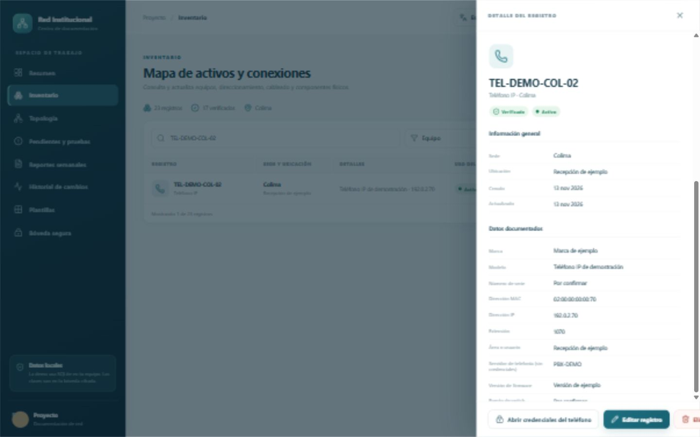

La ficha de `TEL-DEMO-COL-02` reúne extensión, dirección MAC, IP, central telefónica vinculada, puerto, etiqueta de cable, nodo, dispositivo PoE y computadora conectada al puerto PC. Las diademas, auriculares, módulos de expansión y fuentes pueden tener una ficha propia vinculada al teléfono. En la imagen se muestran una diadema activa y un adaptador que está en reserva: su estado de uso se sigue por separado del teléfono. El botón **Abrir credenciales del teléfono** lleva a la bóveda; la ficha técnica no contiene la contraseña.

## 8. Bóveda: credenciales y respaldo cifrado

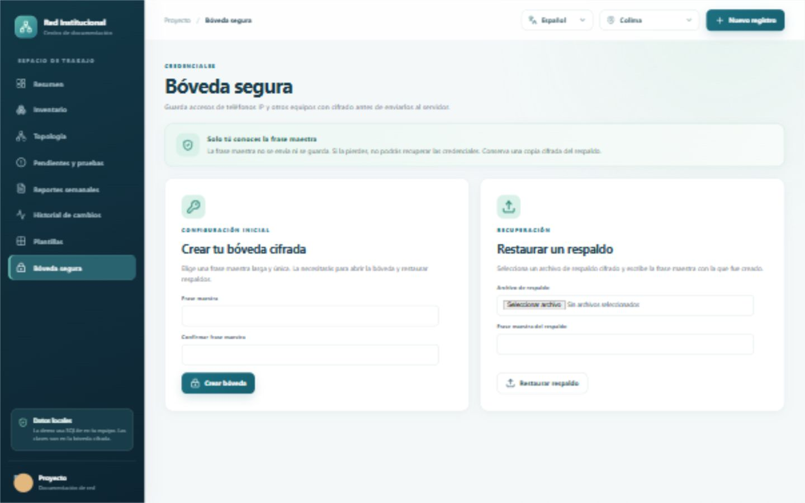

La bóveda se crea o abre con una frase maestra. Su pantalla permite añadir accesos vinculados a equipos, bloquear la sesión y descargar un respaldo cifrado. La captura muestra únicamente el estado inicial vacío. La clave maestra no se guarda ni se envía al servidor; si se pierde, tampoco puede abrirse un respaldo. Consulta [SEGURIDAD.md](SEGURIDAD.md) antes de guardar datos propios.

## Actualización: central telefónica y planta de telefonía

La ficha `PBX-DEMO-COL-01` documenta una central física de ejemplo. Incluye marca y modelo, IP de gestión, VLAN de voz, rango y capacidad de extensiones, proveedor y referencias de troncales SIP, puertos FXO/FXS, rack, respaldo de configuración y responsable. La plantilla también permite registrar rutas de llamadas, IVR, colas, horarios, grabación y plan de contingencia. Debajo aparecen los teléfonos IP vinculados con su extensión y estado de uso. El visor de topología también dibuja la relación de telefonía IP.

Después de guardar una central nueva se abre su ficha. **Abrir credenciales de la central** lleva a la bóveda cifrada. Allí se crea una entrada vinculada a esta PBX para cada acceso: administración, troncal SIP o SSH, con usuario, contraseña, dirección y notas privadas. El archivo de respaldo de la bóveda sigue cifrado. La ficha técnica guarda solo la referencia del respaldo de configuración de la PBX, sin claves ni archivo privado.

## 9. Tema oscuro: una vista para trabajo prolongado

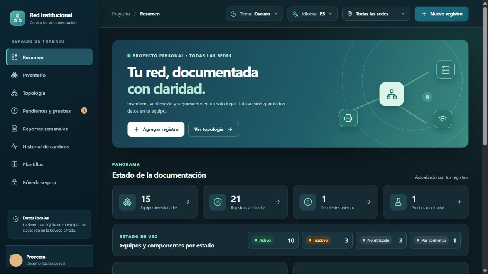

La vista oscura conserva la estructura del panel y aumenta la separación visual entre navegación, tarjetas y datos. El mismo tema se aplica a tablas, formularios, diagramas y bóveda. El selector permanece en la barra superior para cambiar de aspecto sin salir de la sección actual.

## 10. Idiomas: seis opciones desde la barra superior

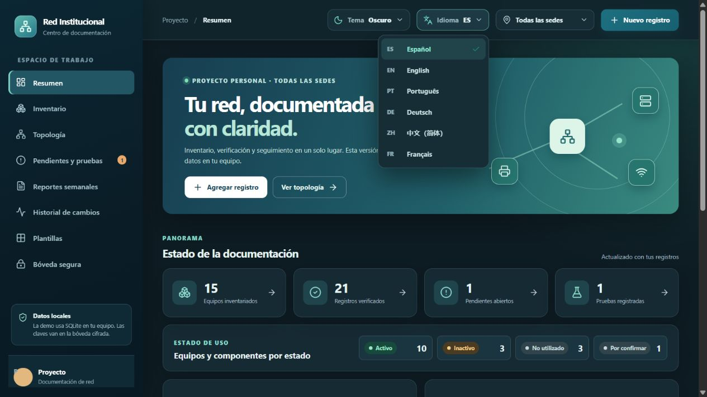

El botón **Idioma** permite elegir español, inglés, portugués, alemán, chino simplificado o francés. Cambian los títulos, menús, filtros, estados, formularios y fechas. Los nombres y notas escritos por el usuario se conservan en su idioma original. Las traducciones están incluidas en la aplicación, así que el cambio no envía registros ni secretos fuera de ella.

## 11. Apariencia: claro, oscuro o automático

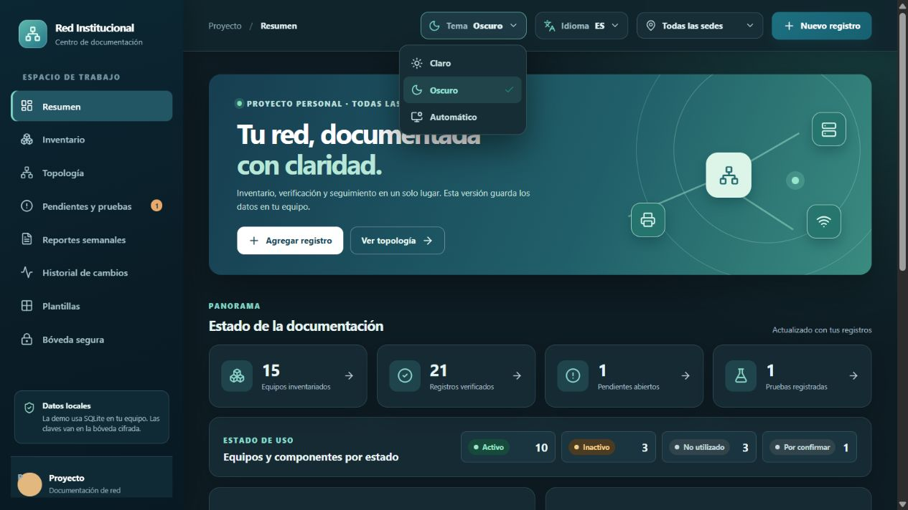

**Claro** y **Oscuro** fijan la apariencia elegida. **Automático** sigue el modo configurado en Windows o macOS y se adapta si esa preferencia cambia mientras la aplicación está abierta. La elección de tema e idioma queda guardada en el navegador para futuras visitas.

## 12. Panel renovado: empezar por la tarea importante

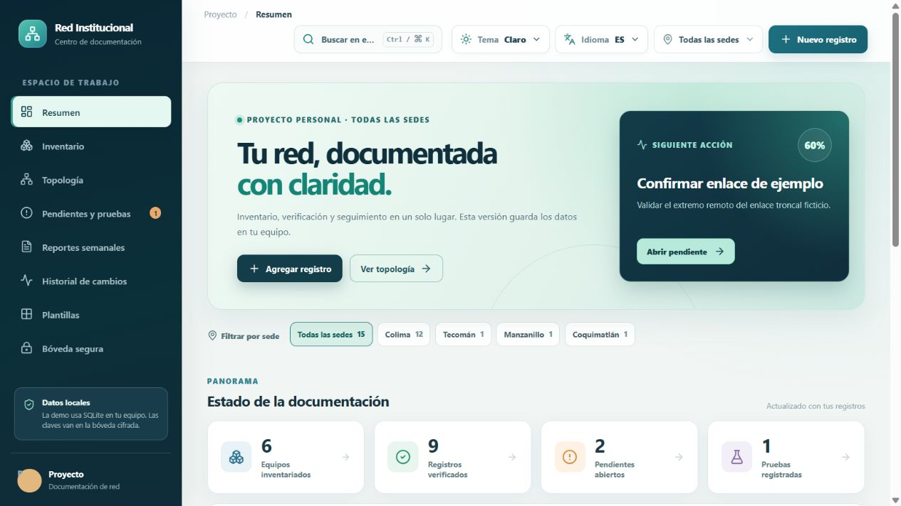

El bloque **Siguiente acción** presenta el primer pendiente abierto, una inconsistencia detectada o las fichas por revisar según el estado de los registros. Su botón abre la sección o ficha relacionada. Los indicadores de equipos, verificación, pendientes y pruebas también son botones: llevan al inventario o a la lista de seguimiento con el filtro correspondiente. Los botones de sede actualizan el contenido del panel y sus cifras.

## 13. Búsqueda rápida: ir directamente a una ficha

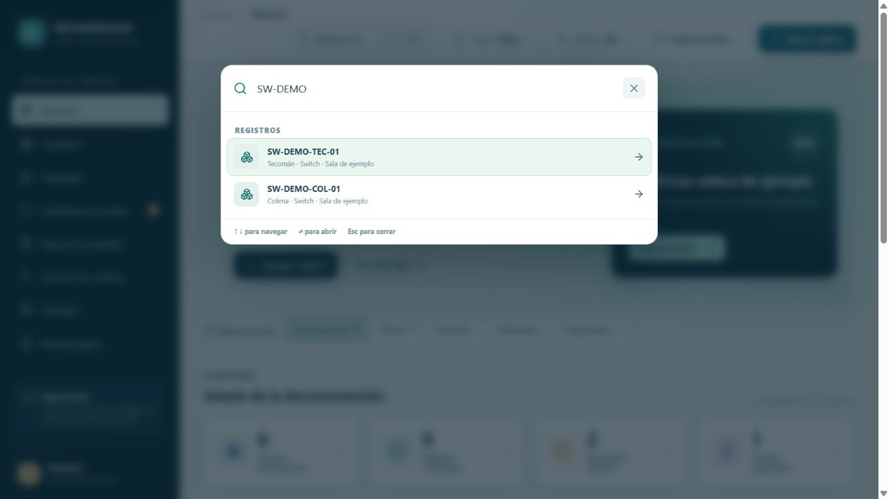

**Buscar en el proyecto** permite localizar una sección, equipo, IP o sede sin recorrer primero el inventario. La captura muestra dos switches de demostración. Al elegir uno, la aplicación cambia a su sede y abre la ficha. El atajo es **Ctrl+K** en Windows o **⌘K** en macOS. Las flechas, Enter y Escape permiten usarlo con teclado.

## 14. Tema oscuro renovado

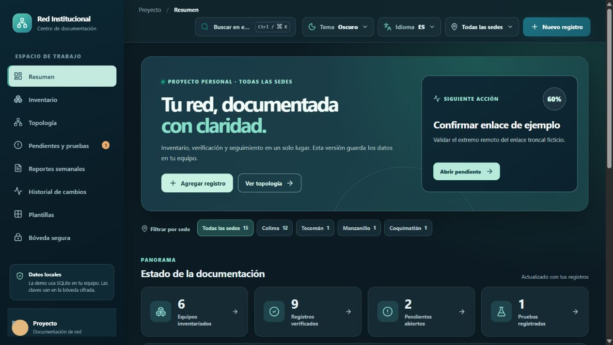

La variante oscura mantiene la jerarquía del panel, diferencia la acción principal y conserva contraste en tarjetas y controles. La elección de tema sigue disponible en la barra superior.

## 15. Pantalla estrecha: controles a la vista

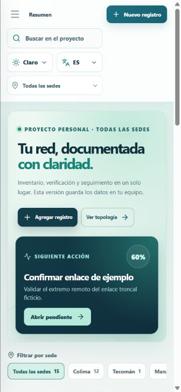

En un teléfono, la barra distribuye el alta de registros, la búsqueda, las preferencias y la sede en filas legibles. El panel muestra la acción prioritaria antes de las métricas. Los botones de las sedes se desplazan dentro de su propia fila y la tabla de inventario se desplaza dentro de su tarjeta, sin ensanchar la página completa.

## Cómo recorrer la demostración

1. Instala y ejecuta el proyecto siguiendo [INSTALACION.md](../INSTALACION.md). En una base nueva, `npm run seed:demo` agrega registros ficticios.
2. En **Resumen**, observa el avance general y el estado de uso de los equipos.
3. En **Inventario**, prueba los filtros de sede, tipo, verificación y uso; abre una computadora o una etiqueta de cable.
4. En **Topología**, compara el diagrama con los puertos y cables de ejemplo.
5. En **Reportes semanales** y **Plantillas**, revisa cómo se documenta el trabajo y se añaden fichas nuevas.
6. Prueba **Buscar en el proyecto**, los indicadores y los filtros de sede; después cambia **Tema** e **Idioma** desde la barra superior. En **Bóveda segura** puedes revisar el flujo de creación sin introducir secretos reales en la demostración.

Los datos locales se guardan en `data/network.sqlite`, archivo excluido de Git. El proyecto público comparte el **código y estas capturas de demostración**; no publica la base de datos ni credenciales.
